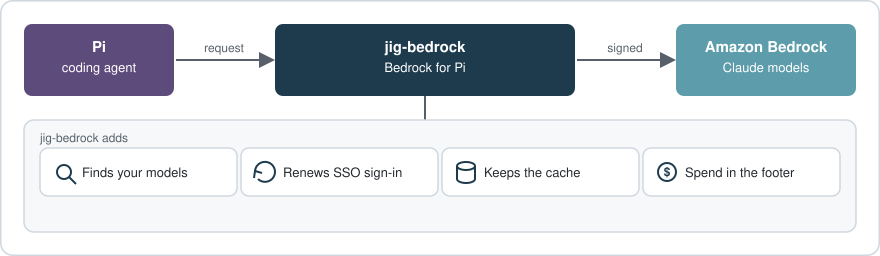
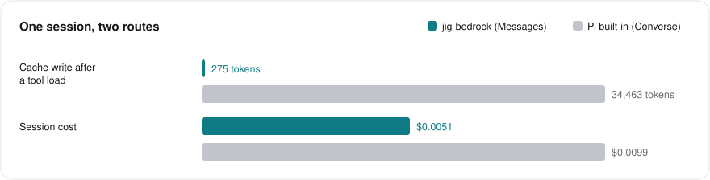
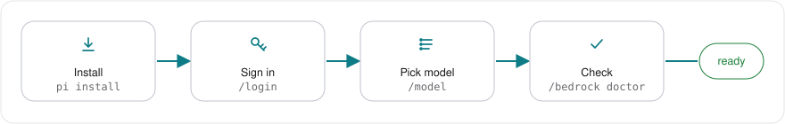

# jig-bedrock

Claude on AWS Bedrock for the Pi coding agent, signed in with your AWS profile.



_One package in front of Amazon Bedrock._

## Why use it

- Cache survives a tool load on four models: 275 vs 34,463 tokens.
- All Claude models your account allows, including profiles found by tag.
- An expired SSO sign-in renews, and the request is sent once more.
- Month spend and budget in Pi's footer.



_Claude Haiku 5.5, one prompt of about 34,000 tokens._

## Set up



_Install, sign in, pick, check._

Node 22.19+, Pi 1.5 or later, AWS CLI v2, and an AWS profile that can call Bedrock.

**1. Install**

```sh
pi install npm:@clawdbuilder/jig-bedrock
```

Done when `pi list` shows `npm:@clawdbuilder/jig-bedrock`.

**2. Sign in**

```text
Select authentication method:
→ Sign in with an API key
Select provider to configure:
→ Amazon Bedrock (jig-bedrock)
How do you sign in to AWS?
→ An AWS profile that already works
  Create an IAM Identity Center (SSO) profile
  Create an IAM role profile
  Use the AWS credential chain (no profile)
  Use a Bedrock API key with Pi's own provider
Which AWS profile should Bedrock use?
→ my-profile
Which inference profiles should Bedrock list?
→ All AWS-defined Claude inference profiles
AWS regions for discovery (comma separated)
> us-east-1
```

```text
Bedrock models loaded: 31. Choose one with /model.
```

The API key asks for no key; Pi's red no-default-model warning is expected until step 3.

Done when the last line is `Bedrock models loaded:` with a number above 0.

**3. Pick a model**

```text
> sonnet-5-5
→ claude-sonnet-5-5-global [jig-bedrock]
  claude-sonnet-5-5 [jig-bedrock]
  Model Name: Claude Sonnet 5.5 · global
```

`-global` is explained under [Model ids](docs/how-it-works.md#model-ids).

Done when the footer shows the chosen id and `Nov $0.00`.

**4. Check**

```text
/bedrock doctor
```

```text
Bedrock doctor
✓ Node 26.13.0
✓ AWS CLI 2.34.46
✓ Settings: ~/.pi/agent/bedrock.json
✓ AWS profile: my-profile (from /login)
✓ Sign-in: AWS answered
✓ Models: 31 found in us-east-1 (AWS-defined)
✓ Selected model: claude-sonnet-5-5 · Messages route
– Spend command: not set
Bedrock is ready.
```

Done when the last line is `Bedrock is ready.`

## Budget

```text
/bedrock budget 200
```

The footer shows the month and spend, for example `Nov $12.40 / $200`. It is not an AWS limit. [Details](docs/how-it-works.md#spend-and-the-footer).

## Compared with Pi's built-in Bedrock provider

|                  | Pi built-in            | jig-bedrock         |
| ---------------- | ---------------------- | ------------------- |
| Sign-in          | API key or environment | AWS profile         |
| Models           | Pi's list              | Your account        |
| Cache after tool | Rewritten              | Kept on four models |

## Commands

| Command            | What it does                                  |
| ------------------ | --------------------------------------------- |
| `/bedrock status`  | Profile, sign-in, models, route, spend.       |
| `/bedrock doctor`  | Checks everything; one next step.             |
| `/bedrock models`  | Models, route and price.                      |
| `/bedrock refresh` | Reads the models now, whatever the cache age. |
| `/bedrock login`   | Renews the AWS sign-in.                       |
| `/bedrock usage`   | Spend by model, day, week or month.           |

## When something is wrong

| You see                            | Run                |
| ---------------------------------- | ------------------ |
| Sign-in expired                    | `/bedrock login`   |
| Access denied                      | `/bedrock doctor`  |
| No models in `/model`              | `/bedrock refresh` |
| A model is missing after an update | `/bedrock models`  |
| The footer shows no amount         | `/bedrock usage`   |

[Troubleshooting](docs/troubleshooting.md) has the exact screens and permissions.

## Limits

- Linux and WSL tested; macOS CI only; no native Windows.
- A Bedrock API key uses Pi's built-in provider.
- Spend counts this machine's Pi sessions, unless `spendCommand` is set.
- The budget never blocks a request.
- Only SSO sign-ins are renewed.

## Update and uninstall

Update: `pi update npm:@clawdbuilder/jig-bedrock`, then `/reload`. Remove: `/logout`, then `pi remove npm:@clawdbuilder/jig-bedrock`. Files left: [Files on disk](docs/settings.md#files-on-disk).

## More detail

| Page                                       | Read it when                         |
| ------------------------------------------ | ------------------------------------ |
| [How it works](docs/how-it-works.md)       | Routes, model ids, discovery, spend. |
| [Settings](docs/settings.md)               | You edit `bedrock.json`.             |
| [Troubleshooting](docs/troubleshooting.md) | A command ends with `✗`.             |
| [Spend command](docs/spend-command.md)     | You set `spendCommand`.              |

## For an agent setting this up

Do the four steps in order; check each "Done when" line. Step 2 opens a browser: ask the user to finish it. Never read or print credentials. Done when the doctor says `Bedrock is ready.`

## Licence

MIT.
