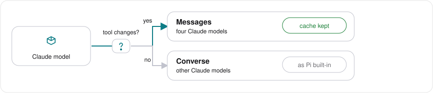
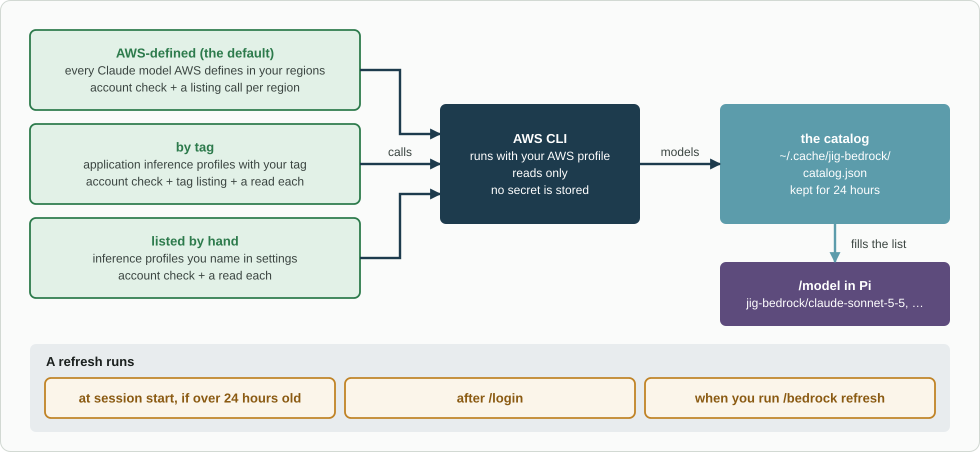
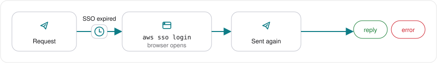

# How it works

Routes, model names, discovery, sign-in repair and spend.

## The words

| Word                              | Meaning                                                                                                |
| --------------------------------- | ------------------------------------------------------------------------------------------------------ |
| **AWS profile**                   | A named sign-in in your AWS CLI configuration, such as `my-profile`. It is who you are to AWS.         |
| **Inference profile**             | One entry AWS lets you call. It has an ARN and points at one foundation model.                         |
| **AWS-defined inference profile** | Made by AWS for everyone; routes within a geography, so its id starts `us.` or `global.`; the default. |
| **Application inference profile** | Made by your team in your account; can carry tags.                                                     |
| **Model**                         | What you pick in `/model`; one inference profile, named by a short id.                                 |
| **Route**                         | How a request travels: Messages is Bedrock's Anthropic interface; Converse is its general interface.   |
| **Catalog**                       | The saved list of inference profiles found in your account.                                            |

## Which route a model gets

_One question chooses the route._

The rule asks in order; the first answer wins:

1. Not a Claude model? Converse.
2. `api` is `converse`, or the model is in `converseModels`? Converse.
3. The model is in `messagesModels`? Messages.
4. A known exception, today Opus 5? Converse.
5. Pi lists the model and its entry says mid-session tool changes work? Messages. Otherwise Converse.

A model newer than the installed Pi uses Converse until Pi is updated or the model is added to `messagesModels`. `/bedrock models` shows the reason: `Pi lists tool changes`, `not on the Messages route`, `your setting`, `known exception` or `this Pi does not know the model`.

| Model                                               | Route    | Result                  |
| --------------------------------------------------- | -------- | ----------------------- |
| Haiku 5.5, Sonnet 5.5, Opus 5.5, Opus 4.8           | Messages | Works; cache kept       |
| Fable models                                        | Messages | Not tested; AWS refused |
| Opus 5                                              | Converse | 400 with thinking high  |
| Sonnet 5, Opus 4.7, Opus 4.6, Sonnet 4.6, Haiku 4.5 | Converse | 400 after a tool load   |
| Opus 4.5, Sonnet 4.5, Opus 4.1                      | Converse | 404 on Messages         |

Both routes stream the reply. Messages declares only the 5-minute cache lifetime, so `PI_CACHE_RETENTION=long` does nothing there. Converse keeps both lifetimes.

## How models are found

_Three sources, one read-only catalog._

The settings choose one way; there is no fallback.

- **AWS-defined (default):** lists the AWS-defined inference profiles in each region. Only Claude entries with status `ACTIVE` are kept.
- **By tag:** reads application inference profiles with `tagKey` and `tagValue`, then reads each match.
- **Listed by hand:** reads each ARN or id in `profiles`.

Each way starts with `aws sts get-caller-identity`. A call may take 20 seconds; a run stops at 90 seconds. At most 256 inference profiles are kept. An inference profile that points at another is followed up to two levels. `GetFoundationModel` is never called.

The catalog is private, written by atomic rename, and records the AWS profile and settings. A changed setting discards it. An inference profile whose foundation model Pi does not know is not listed; update Pi. A model with no price is listed as `no price`, and its replies count as unpriced. `/bedrock models` names up to three rejected entries.

## Model ids

The short id is the Claude name and version, such as `claude-sonnet-5-5`. The plain id goes to the AWS-defined inference profile of your first region's geography, then `global`, then other regions in order. Another inference profile for the same model gets a longer id, such as `-global`; two application inference profiles for one model both get the longer form. An older id still selects it.

A reply is recorded as `jig-bedrock/<short id>`; the ARN stays off the session list.

## Sign-in repair

_At most one retry._

1. At session start, the saved SSO token's expiry is checked. An expired one gets a `/bedrock login` notice. With `signInAtStart: true` the sign-in starts at once; the default is false.
2. If a request fails before any reply because the SSO session expired, `ssoLoginCommand` (`aws sso login --profile <name>`) runs, then the request is sent once more. Never a third time.
3. `/bedrock login` runs the same sign-in. One login runs at a time; a lock file separates two Pi processes.

A browser opens for the sign-in. On WSL the package opens the Windows browser through `bin/windows-browser`; `browser` names another program. The package never stores a password or token; `/login` stores only the AWS profile name.

Only SSO is repaired. Other sign-in methods: [Settings](settings.md#sign-in-methods).

## What runs when

| When                                 | What happens                                                                     | Calls AWS?       |
| ------------------------------------ | -------------------------------------------------------------------------------- | ---------------- |
| Pi starts the package                | Settings are read; commands and provider are registered.                         | No               |
| A session starts                     | AWS profile chosen; cache read; stale cache refreshes in background.             | Only the refresh |
| A request                            | The route is chosen; credentials are built; an expired sign-in is repaired once. | Yes              |
| A reply ends                         | Spend is recorded; the footer updates; a budget notice may appear.               | No               |
| You open `/model`                    | The saved list shows; a cache older than 24 hours refreshes in the background.   | Only the refresh |
| `/bedrock refresh`, `/bedrock login` | Discovery runs now, whatever the cache age, or the sign-in runs.                 | Yes              |
| `/bedrock doctor`                    | Local checks, then three free AWS calls; `offline` makes none.                   | Yes, free        |

Nothing waits for AWS at start.

## Spend and the footer

- Every reply adds one line to `${XDG_STATE_HOME:-~/.local/state}/jig-bedrock/spend/`; no prompt, ARN, account id or AWS profile name.
- The first reply of a month imports earlier sessions from this agent folder once.
- The footer shows `Nov $12.40`, or `Nov $12.40 / $200` with a budget. A `+` means an unpriced reply.
- Warning colour starts at 80%, error at 100%; the footer clears when another provider's model is selected.
- A `spendCommand` supplies the figure instead: [Spend command](spend-command.md).

[Back to the README](../README.md).
